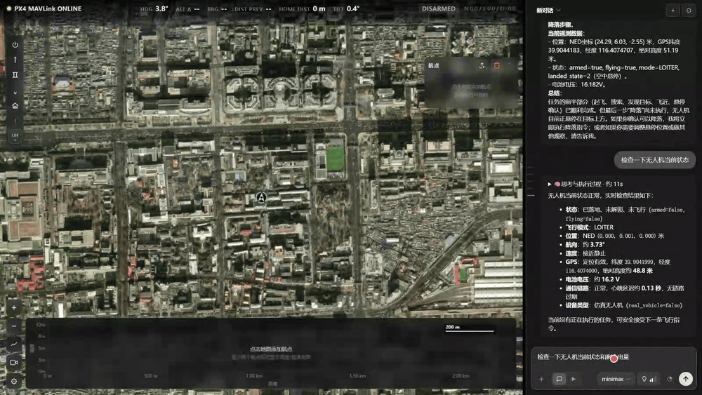
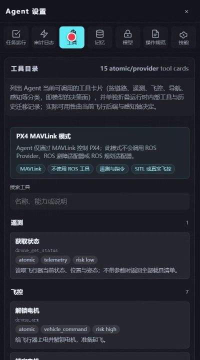
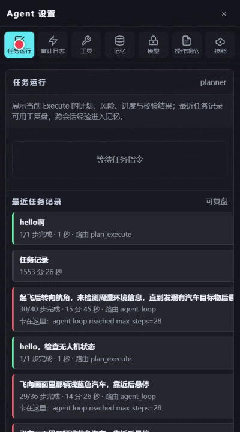
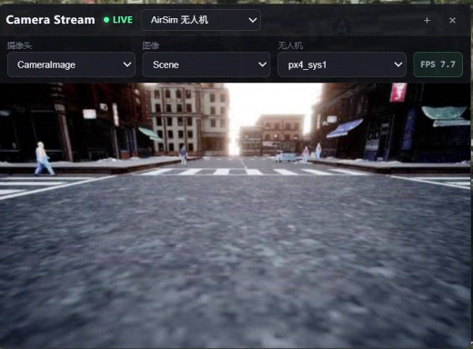
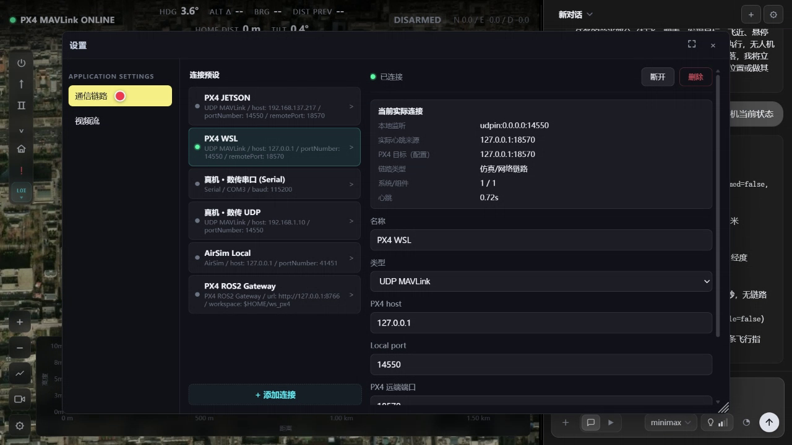

<div align="center">

# AirSim Agent

**用自然语言指挥无人机**

LLM 规划 → 判据契约 → 原子工具 → 飞行器。
Web 地面站和 LLM 智能体共用同一套服务，高风险动作先过安全层和人工审批闸门。

[](https://www.python.org/)



*上面是真实运行录制的动图：左边是整个地面站（卫星底图、实时遥测、飞行工具栏、高度剖面），
右边是 Agent —— 切到 Chat 模式、输入「检查一下无人机当前状态和剩余电量」，
模型现场从 PX4 SITL 读遥测（模式 / 位置 / GPS / 电池 / 心跳）后作答。*

</div>

---

## 能力

| | |
|---|---|
| **Agent 运行时** | 一次决策可以是固定工具序列，也可以是「观察—决策—行动」循环；支持取消、暂停、人工审批 |
| **判据契约** | 完成标准由任务自己声明（`goal.success_criteria`），运行时只评估，不替任务发明标准 |
| **工具面** | manifest 驱动，22 个工具按后端能力动态裁剪后暴露给模型 |
| **多后端** | PX4 MAVLink（主线）/ AirSim（仿真）/ PX4 ROS2（冻结），运行中切换，不用重启 |
| **安全层** | 执行监督器（暂停 / 急停 / 审批）+ 运行时包线看门狗 + 无进展监控 |
| **感知轴** | 视觉模型给语义、深度图给距离，**不用目标检测器** |

## 界面

<table>
<tr>
<td width="50%"><br><sub>工具目录：模型能调用什么，一眼看清</sub></td>
<td width="50%"><br><sub>任务复盘：每次任务的目标、路由与卡点</sub></td>
</tr>
<tr>
<td width="50%"><br><sub>机载相机实时画面</sub></td>
<td width="50%"><br><sub>链路预设与当前实际连接</sub></td>
</tr>
</table>

## 快速开始

需要 Python ≥ 3.10 和 [uv](https://docs.astral.sh/uv/)。

```powershell
uv sync
uv run python -m src.ui.server --host 127.0.0.1 --port 8765 --backend px4_mavlink
```

打开 <http://127.0.0.1:8765/>。后端可在界面「系统设置 → 通信链路」里随时切换。

## 目录

```text
src/            产品代码：agent 运行时 / 工具层 / 多后端 / 地面站服务 / Web UI
.airsim_agent/  Agent 的家：SYSTEM.md（系统提示词）+ NOTES.md + skills/
ros2/           PX4 ROS2 网关（已冻结）
vendor/         msgpack-rpc-python 补丁副本（构建依赖）
```

## 说明

- 仓库尚未指定开源许可证，默认保留全部权利。
- `px4_ros2` 链路已冻结，不再维护；新功能走 PX4 MAVLink 或 AirSim 仿真。
- 这个仓库只放**产品代码与手册**：测试套件、CI 工作流、检测权重、设计文档、飞行数据都留在本机，
  不进版本库。

---

<div align="center">

**[Yookio-Z/Airsim-Agent](https://github.com/Yookio-Z/Airsim-Agent)**

</div>
