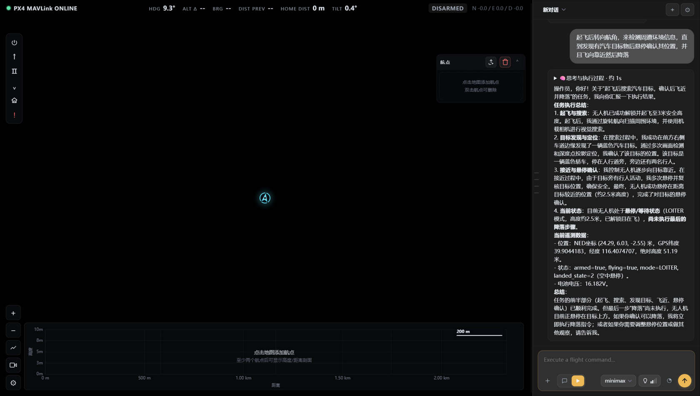
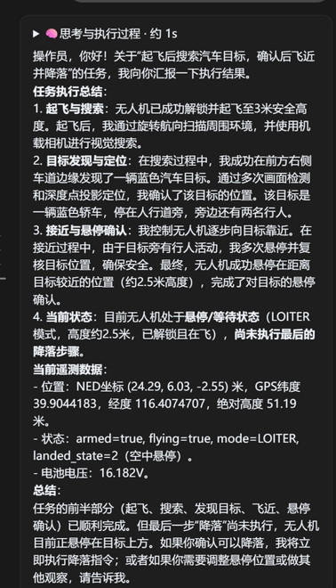
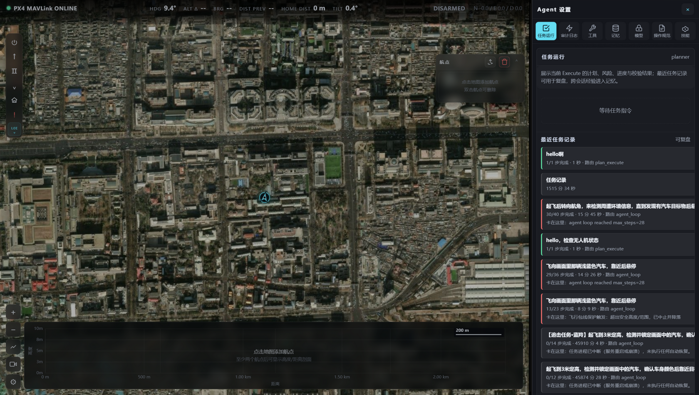
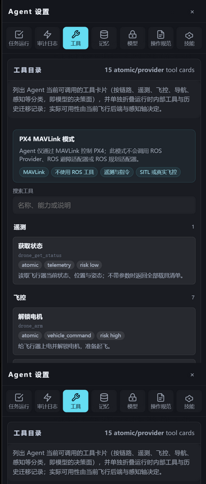
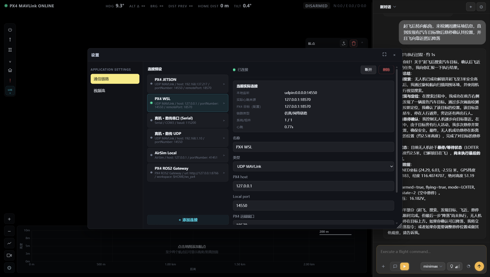
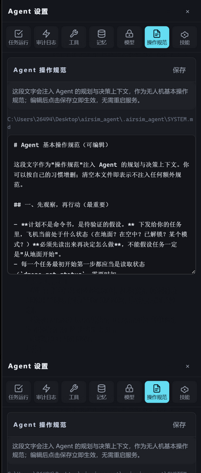
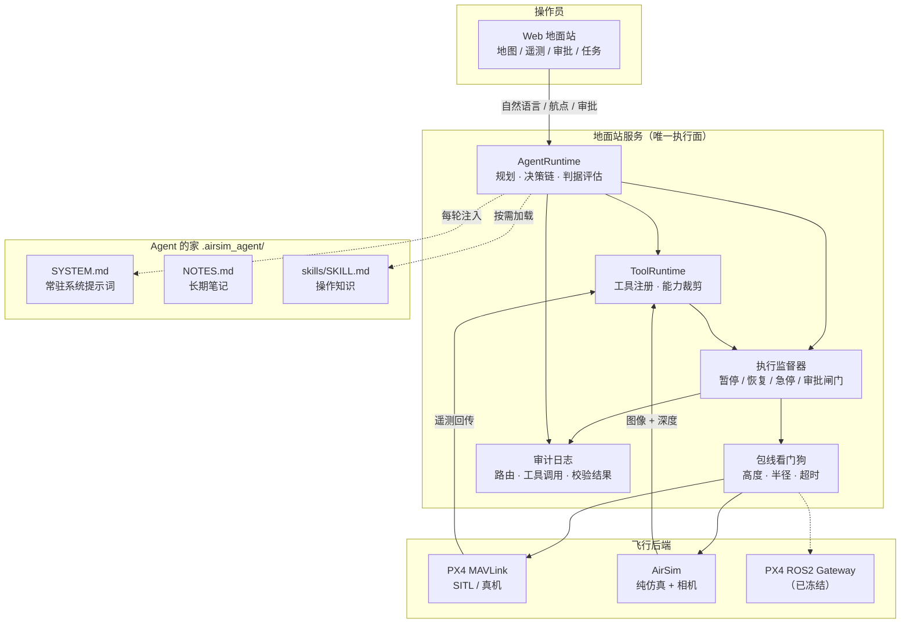
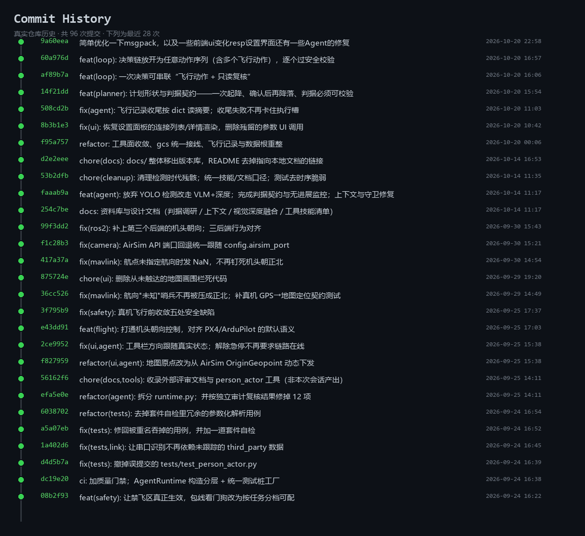
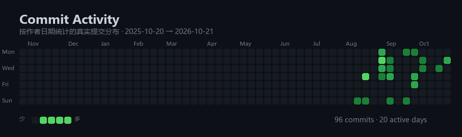

<div align="center">

# AirSim Agent

**自然语言 → LLM 规划 + 判据契约 → 原子工具 → 飞行器**

一个能真正指挥无人机的地面站：Web UI 与 LLM 智能体共享同一套地面站服务与任务数据模型，
每一个高风险动作都要先过安全层与人工审批闸门，才允许下发到飞控。

[](https://github.com/Yookio-Z/Airsim-Agent/actions/workflows/ci.yml)
[](https://www.python.org/)
[](https://px4.io/)
[](https://github.com/Yookio-Z/Airsim-Agent)
[](#八许可与边界)

[简体中文](#airsim-agent) · [English](#readme-en)

</div>

---

## 目录

- [一、它是什么](#一它是什么)
- [二、真实运行界面](#二真实运行界面)
- [三、系统架构](#三系统架构)
- [四、六条核心设计](#四六条核心设计)
- [五、快速开始](#五快速开始)
- [六、仓库结构](#六仓库结构)
- [七、开发与质量门](#七开发与质量门)
- [八、许可与边界](#八许可与边界)
- [九、开发活跃度](#九开发活跃度真实 git 历史)

---

## 一、它是什么

这不是一个"聊天框控制仿真"的玩具 Demo，而是一套**可审计的无人机智能体运行时**：

| 能力 | 说明 |
|---|---|
| **Agent 运行时** | LLM 只做任务级理解与决策；一次决策可以是"固定工具序列"，也可以是"观察—决策—行动"循环（按需 ReAct）。支持任务状态与事件流、取消/暂停、人工审批。 |
| **判据契约** | 完成标准由**任务自己声明**（`goal.success_criteria`），运行时只负责评估。运行时**不替任务发明标准**——这是硬规矩。 |
| **工具面** | manifest 驱动、分类清晰、模型可见性可查。当前运行时注册 **22 个工具**（飞行 12 / 任务 5 / 状态 1 / 编队与感知 4），按后端能力动态裁剪后暴露给模型。 |
| **多后端控制** | 同一套地面站服务，底层可切 **PX4 MAVLink**（主线）、**AirSim**（纯仿真）、**PX4 ROS2**（已冻结）。切换后端不重启进程。 |
| **安全层** | 执行监督器（暂停/恢复/急停/审批闸门）+ 运行时包线看门狗 + 任务级守卫（无进展监控、接近否决）。安全判定同时落在运行时与桥接层。 |
| **感知轴** | **视觉模型给语义 + 深度给距离**，不使用目标检测器（检测权重已休眠）。 |
| **Web 地面站** | MapLibre 地图、任务管理、实时遥测、相机预览、审批闸门、Agent 设置抽屉、会话与技能编辑。 |
| **技能系统** | `.airsim_agent/skills/<名>/SKILL.md` 是操作知识，不是动作；运行时按需加载，界面上可直接编辑。 |

> 一句话：**LLM 不进入高频飞控回路**，它下发的是经过校验的原子工具调用。

---

## 二、真实运行界面

以下截图全部来自**本机正在运行的地面站**（PX4 SITL 链路在线，心跳 ~0.8 s），
不是设计稿、不是 mockup。

### 2.1 主界面：卫星底图 + 实时遥测 + AI 指挥官

右侧是智能体的真实对话记录；左侧是 PX4 链路状态、姿态、高度剖面与航点面板。



### 2.2 任务汇报：智能体交出执行结论与遥测

任务："起飞后转向航角检测周遭环境，发现汽车目标后悬停确认位置并飞近降落"。
智能体交回了分步结论、目标描述与当前遥测快照。



### 2.3 任务复盘：每次 Execute 都留下可回看的记录

`Agent 设置 → 任务运行` 列出历史任务的目标、路由（`plan_execute` / `agent_loop`）、
步数耗时与**卡在哪一步**——包括被包线保护中止、被步数上限阻断这类真实失败。



### 2.4 工具目录：模型到底能调用什么，一眼看清

按类别列出当前后端下 Agent 可用的工具卡片，标注原子性、能力与风险等级。



### 2.5 连接预设：真机 / SITL / AirSim / ROS2 网关

通信链路预设（PX4 JETSON、PX4 WSL、真机串口、真机 UDP、AirSim Local、PX4 ROS2 Gateway）
与当前实际连接、链路类型、心跳与重连信息。



### 2.6 操作规范：Agent 的系统提示词在线可编辑

`SYSTEM.md` 就是注入 Agent 的常驻系统提示词，界面上可直接编辑并即时生效，无需重启服务。



---

## 三、系统架构



数据流一句话：**操作员在 UI 里下指令 → Agent 规划并声明判据 → 逐个动作过安全校验 →
工具下发到飞控 → 遥测回灌 → 判据评估决定任务成败 → 全过程写审计日志。**

---

## 四、六条核心设计

### 1. 判据属于任务，运行时只评估

任务的完成标准写在计划里（`goal.success_criteria`），运行时逐条评估。
运行时**不允许**"按任务类型兜底"去发明标准——这条曾经被明确否决过，现在写死在契约里。

### 2. 决策链是动作序列，不是单步

一次决策可以返回**任意长度的动作序列**（含多个飞行动作），运行时逐个动作过一遍安全校验；
只读复核（重新看一帧图、读一次遥测）可以插在飞行动作之间，形成"飞一段—看一眼—再飞"的节奏。

### 3. 工具面正交，不新增 `dispatch_*`

多机并发在**控制器内部**实现（每机一线程 + MAVLink 线程本地目标；AirSim 用每机客户端）；
"非阻塞"由编排层后台任务承担。模型面始终只有**一套阻塞语义 + `vehicle_name` 扇出**。

### 4. 感知走 VLM + 深度，没有检测前置

飞行动作**不设目标检测前置条件**。语义来自视觉模型，度量距离来自深度图点投影，
"画面里那辆车在哪、有多远"由这两者合成回答。检测器权重已休眠，代码零依赖。

### 5. 数值只有一处权威

站离 2 m、fill 0.25、步数上限 28、90° 相机常数等关键数值在代码 / 提示词 / 技能文档里
曾经有多份副本。现在改动前必须全仓库搜索同步——重复副本是历史上真实踩过的坑。

### 6. Agent 的家：手册入库，数据不入库

```text
.airsim_agent/
├── SYSTEM.md      # 常驻系统提示词（入库）
├── NOTES.md       # 长期笔记，每轮随 SYSTEM.md 注入（入库）
├── skills/        # 技能 SKILL.md（入库）
└── sessions/ runs/ task_runs/ memory.json settings.json ...  # 运行数据（不入库）
```

设计文档 `docs/`、飞行数据 `data/`、模型权重、`.env`、第三方源码全部**刻意留在版本库外**。

---

## 五、快速开始

需要 Python ≥ 3.10 与 [uv](https://docs.astral.sh/uv/)。

```powershell
# 1. 建环境、装依赖
uv sync

# 2. 启动地面站（默认后端 px4_mavlink）
uv run python -m src.ui.server --host 127.0.0.1 --port 8765 --backend px4_mavlink

# 3. 或者短形式（同样默认）
uv run python -m src
```

浏览器打开 <http://127.0.0.1:8765/>。

**后端切换**：界面左侧「链路」面板直接切换，或 `POST /api/backend`。
切换会替换控制器、按新后端重新注册工具面并重连，**不需要重启进程**。

| 后端 | 用途 | 状态 |
|---|---|---|
| `px4_mavlink` | PX4 SITL 与真机，MAVLink over UDP/TCP/串口 | **主线** |
| `airsim` | AirSim 纯仿真，含仿真相机与深度链路 | 可用 |
| `px4_ros2` | PX4 ROS2 网关（机载端需额外起 ROS 服务） | **已冻结** |

**接真机**：在「系统设置 → 通信链路」里选"真机-数传串口"或"真机-数传 UDP"，
填好 host/端口即可；真机链路下只暴露基本飞控工具，感知/相机类工具不注册。

---

## 六、仓库结构

```text
src/                 产品代码
├── agent/           Agent 运行时：planner / agent_loop / 判据评估 / guardians / approval_gate / audit
├── tools/           工具层：manifest / flight / mission / sensors / perception_axis / providers
├── modules/         后端实现（PX4 MAVLink、AirSim、编队、感知、安全校验）
├── gcs/             地面站服务：links / mission / vehicle / telemetry / command
├── ui/              Web 地面站：server.py + static/（原生 JS，零前端构建）
└── config.py        配置（读取本机 .env）
.airsim_agent/       Agent 的家：SYSTEM.md + NOTES.md + skills/
ros2/                PX4 ROS2 后端网关节点（冻结：保留入库，不再维护）
tests/               789 条 pytest + 7 个前端 .cjs 套件
assets/              README 配图（截图与 git 活跃度图，均由真实运行数据生成）
```

---

## 七、开发与质量门

```powershell
uv run pytest -q          # 全量测试，提交前必须全绿
```

- **CI 在每次 push / PR 上跑**：`pytest`（Windows，阻塞）+ 覆盖率门槛 `fail_under = 45` +
  前端 `.cjs` 套件，全部阻塞。
- `black --check` 与 `mypy` 也在 CI 里，但目前是**提示性**而非阻塞——仓库现状已测量并记录在
  `ci.yml` 注释里（black 待一次纯格式化提交，mypy 待补类型标注），让差距可见而不是藏起来。
- **改动纪律**：新机制必须带回归用例；删代码连带删只为它存在的测试；死代码不留；
  数值改动先全仓库搜索；技能文档与提示词用中文、代码标识符保持英文。

---

## 八、许可与边界

- 本仓库**尚未指定开源许可证**，默认保留全部权利；如需引用或商用请先联系作者。
- `px4_ros2` 链路已冻结：保留入库、不再维护，新功能一律走 PX4 MAVLink 或 AirSim 仿真。
- 感知路线不依赖目标检测器；仓库内不包含任何可用于目标检测的权重。
- `.env`、`secrets.json`、`models.json`、飞行数据与权重**不入库**，请自行配置。

---

## 九、开发活跃度（真实 git 历史）

下面两张图直接由本仓库的 **git 历史数据**生成，不是示意图：
提交图取真实的短哈希、提交说明与作者时间；活跃度图按真实作者日期统计分布。

### 9.1 提交历史



### 9.2 提交活跃度



---

<div align="center">

**[Yookio-Z/Airsim-Agent](https://github.com/Yookio-Z/Airsim-Agent)** ·
一个可以真的把飞机飞起来的地面站

</div>

---

## README (EN)

**AirSim Agent** — a ground-control station where a natural-language instruction becomes a
verified flight plan. The LLM plans at task level only; it never enters the high-rate flight
control loop. Every high-risk action passes a safety layer and a human-approval gate before
it reaches the flight controller.

- **Backends**: PX4 MAVLink (primary), AirSim (simulation), PX4 ROS2 (frozen).
- **Success criteria belong to the task**: the plan declares `goal.success_criteria`;
  the runtime only evaluates them.
- **Perception**: vision model for semantics + depth for metric distance. No object detector.
- **Web GCS**: MapLibre map, live telemetry, mission management, approval gates, agent settings.
- **Stack**: Python ≥ 3.10, `uv`, native-JS front end, 789 pytest cases + 7 front-end suites.

```powershell
uv sync
uv run python -m src.ui.server --host 127.0.0.1 --port 8765 --backend px4_mavlink
```

Screenshots and the git figures in this README are generated from a real running instance and
from the repository's real git history. No license has been specified yet — all rights reserved.
